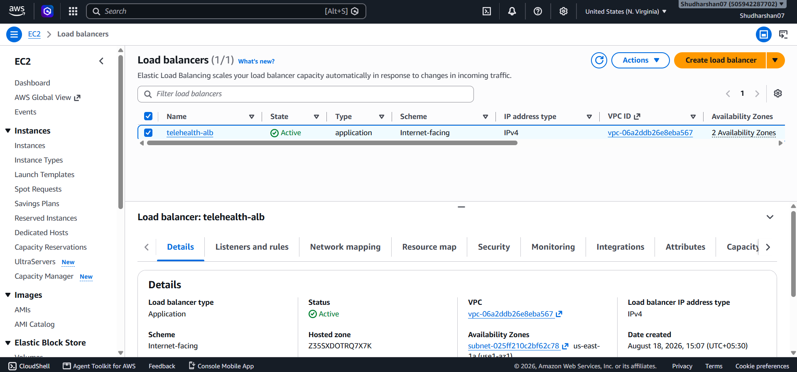
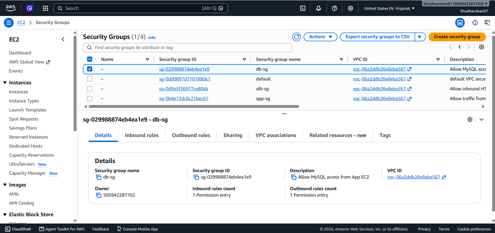
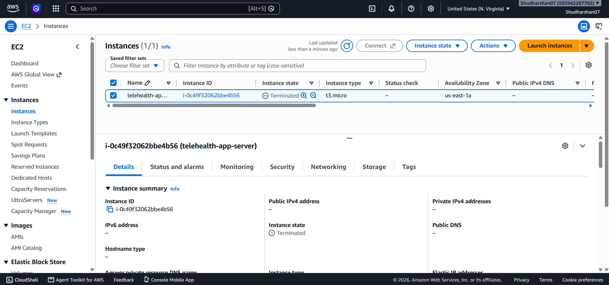

# BookFast - Scalable AWS Infrastructure

BookFast is an online ticket-booking application for movies, concerts, and sporting events. This project demonstrates how to deploy the application on AWS with **automatic scaling, load balancing, health checks, monitoring, IAM, security groups, and S3 storage**.

## Architecture

The infrastructure uses an **Application Load Balancer (ALB)** to distribute incoming requests across healthy EC2 instances. An **Auto Scaling Group (ASG)** automatically increases or decreases the number of EC2 instances based on workload.

```text
                         Users
                           |
                           v
                Application Load Balancer
                           |
                     Target Group
                    /             \
                   v               v
              EC2 Instance     EC2 Instance
              BookFast App     BookFast App
                   \               /
                    \             /
                     Auto Scaling
                        Group
                           |
                       CloudWatch
                    CPU / Load Metrics

              Supporting Services
             ┌─────────┬─────────┐
             │  IAM    │   S3    │
             │Security │ Storage │
             │ Groups  │         │
             └─────────┴─────────┘
```

## AWS Services Used

| AWS Service                   | Purpose                                     |
| ----------------------------- | ------------------------------------------- |
| **EC2**                       | Hosts the BookFast application              |
| **Application Load Balancer** | Distributes incoming traffic                |
| **Auto Scaling Group**        | Automatically adds/removes EC2 instances    |
| **CloudWatch**                | Monitors CPU and workload                   |
| **IAM**                       | Provides controlled access to AWS resources |
| **Security Groups**           | Controls inbound and outbound traffic       |
| **S3**                        | Stores application assets                   |

## Implementation

### 1. EC2

EC2 instances were configured with the BookFast application. Multiple instances are maintained by the Auto Scaling Group to handle increased traffic.

The configuration used:

* Minimum instances: **2**
* Desired instances: **2**
* Maximum instances: **5**

### 2. Application Load Balancer

An Application Load Balancer was created to provide a single entry point for users.

```text
User Request
     |
     v
    ALB
     |
     v
Target Group
     |
 ┌───┴────┐
EC2-1    EC2-2
```

The ALB performs health checks and sends requests only to healthy instances.

### 3. Auto Scaling

The Auto Scaling Group manages the EC2 instances.

When the workload increases:

```text
High Traffic
     ↓
High CPU Utilization
     ↓
CloudWatch Alarm
     ↓
Auto Scaling
     ↓
New EC2 Instance
     ↓
ALB adds healthy instance
```

When the workload decreases, unnecessary instances can be removed automatically.

### 4. CloudWatch

Amazon CloudWatch was used to monitor:

* EC2 CPU utilization
* Application workload
* Scaling activity
* Instance health

CloudWatch metrics are used by the Auto Scaling policy to determine when additional instances are required.

### 5. IAM

An IAM role was attached to the EC2 instances to provide controlled access to required AWS services.

The application can access S3 without storing AWS access keys directly inside the application.

### 6. Security Groups

Security Groups were configured so that users access the application through the ALB.

```text
Internet
   |
   | HTTP : 80
   v
 ALB Security Group
   |
   | HTTP : 80
   v
EC2 Security Group
```

The EC2 instances are not directly exposed to the public Internet.

### 7. S3 Storage

Amazon S3 was used to store BookFast application assets such as:

```text
bookfast-assets/
├── movies/
├── concerts/
└── sports/
```

The EC2 IAM role provides the required access to these objects.

---

## Load Testing

To demonstrate automatic scaling and traffic distribution, concurrent requests were generated against the ALB.

Example using ApacheBench:

```bash
ab -n 5000 -c 100 http://<ALB-DNS>/
```

Where:

* `5000` = total number of requests
* `100` = concurrent requests

The increased workload causes EC2 utilization to rise, allowing the Auto Scaling policy to launch additional instances.

---

## Health Check Demonstration

The ALB continuously checks the health of the EC2 instances.

If an instance becomes unavailable:

```text
EC2 Instance
     ↓
Health Check Failed
     ↓
ALB marks instance Unhealthy
     ↓
Traffic removed from instance
     ↓
Traffic continues through healthy instances
     ↓
Auto Scaling replaces instance
```

This prevents failed instances from receiving new requests.

---

## Screenshots

### AWS Infrastructure

The AWS resources including the load balancer, EC2 instances, and supporting infrastructure are shown below.



### Auto Scaling / CloudWatch

The scaling and monitoring configuration can be verified through the AWS console.



### Load Balancing / Deployment

The deployed BookFast application and traffic distribution can be verified through the ALB and EC2 instances.



---

## Result

The BookFast application was successfully deployed on AWS using **EC2, Application Load Balancer, Auto Scaling, CloudWatch, IAM, Security Groups, and S3**.

The implementation demonstrates:

* Automatic traffic distribution
* Health-based request routing
* Automatic EC2 scaling
* CloudWatch-based monitoring
* Secure IAM-based AWS access
* S3-based application storage
* High availability across multiple EC2 instances
